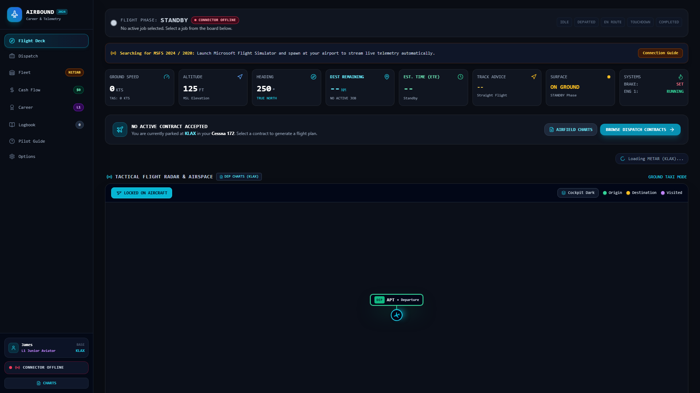
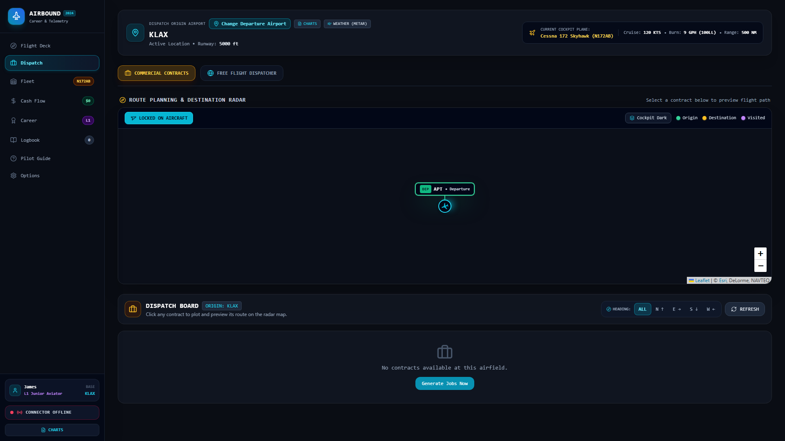
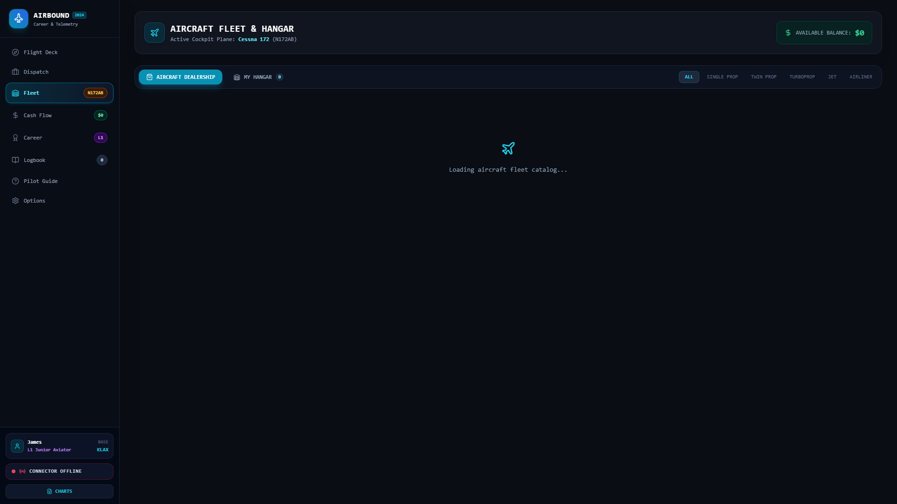
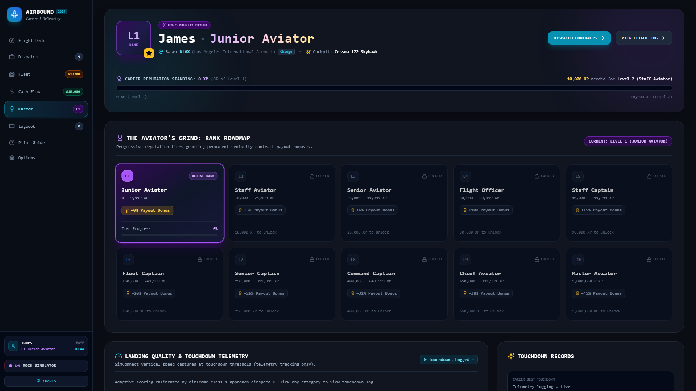
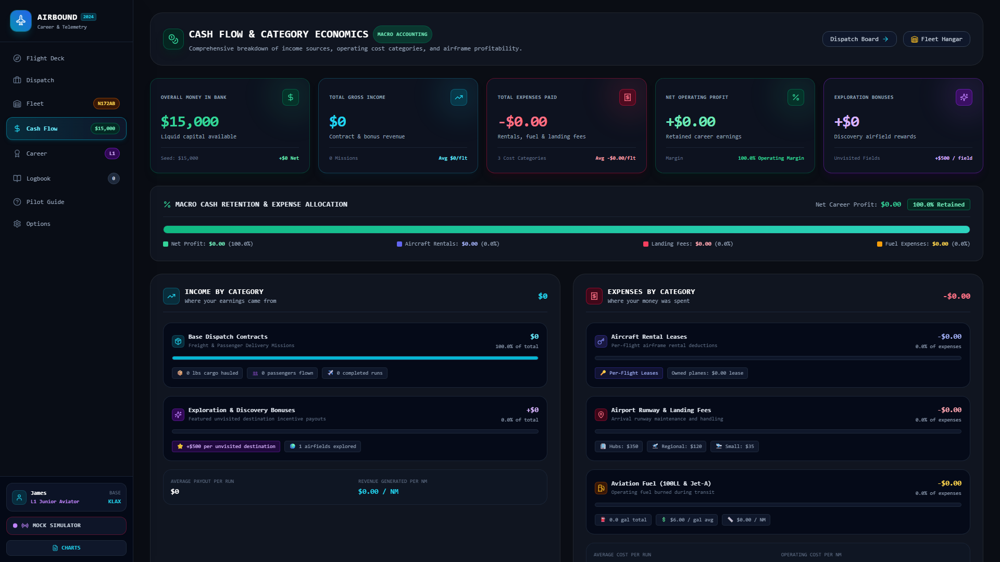
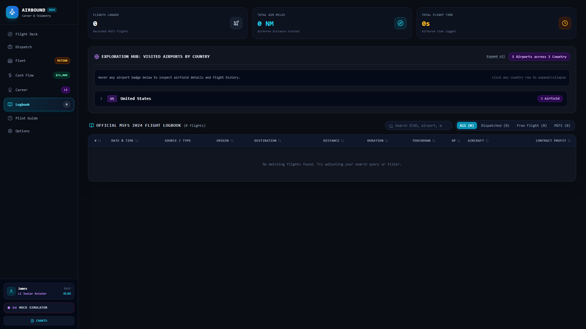
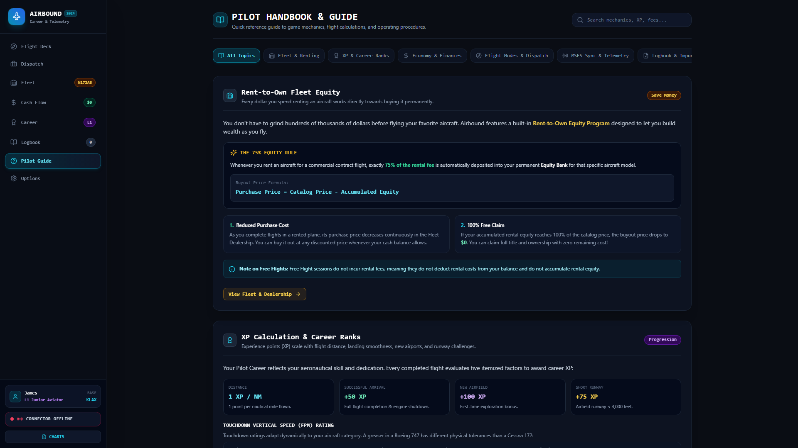

# Airbound — MSFS 2024 Career, Economy & Flight Companion

<p align="center">
  
</p>

<p align="center">
  <strong>Dynamic Contract Dispatch &bull; Real-Time SimConnect Cockpit HUD &bull; Rent-to-Own Fleet Economy &bull; Landing Quality Rating &bull; Automated Logbook</strong>
</p>

<p align="center">
  <a href="https://github.com/whitesoup12/airbound/releases/latest"></a>
  <a href="https://github.com/whitesoup12/airbound/releases"></a>
  
  
  <a href="LICENSE"></a>
</p>

---

**Airbound** is a modern standalone career, economy, and live flight-tracking companion app designed for **Microsoft Flight Simulator 2024** (and MSFS 2020). 

It connects directly to your simulator using native SimConnect, automatically generates distance- and runway-scaled contract jobs from your current parking spot, tracks your flight phases in real time, scores your touchdown vertical speed, and logs every dollar, gallon of fuel, and nautical mile flown into a persistent career ledger.

---

## ⚡ Quick Download

Airbound runs **100% locally on your PC**. It includes an embedded database and native SimConnect integration—**no Node.js, command line, or external database setup required**.

| Package | Recommended For | Description | Download |
| :--- | :--- | :--- | :--- |
| **Airbound Installer** | Most Users | Standard Windows installer (`.exe`) with desktop & Start Menu shortcuts, and auto-update support | [⬇️ Download `Airbound-1.0.0.exe`](https://github.com/whitesoup12/airbound/releases/latest) |
| **Airbound Portable** | Zero Installation | Standalone portable executable. Run directly from any folder or USB drive with zero installation | [⬇️ Download `Airbound-Portable-1.0.0.exe`](https://github.com/whitesoup12/airbound/releases/latest) |

> **Ready to fly in 3 steps:**
> 1. Download and run the executable.
> 2. Launch **Microsoft Flight Simulator 2024** and spawn your aircraft at any airport worldwide.
> 3. Airbound automatically detects your aircraft coordinates via SimConnect and generates contract jobs for your departure airfield!

---

## 📸 Feature Tour

### 🧭 1. Tactical Flight Deck & Real-Time Cockpit HUD
Real-time avionics telemetry streamed directly from SimConnect at up to 2 Hz. Monitor your live airspeed, ground speed, altitude, true heading, pitch/bank attitude, and engine systems on a high-visibility dark glass HUD.

The interactive moving map plots your custom GPS flight plan, origin and destination airfields, breadcrumb path, and markers for every airport you've visited across your aviation career.



* **Autonomous Flight State Machine**: Smoothly steps through `IDLE` ➔ `DEPARTED` ➔ `EN ROUTE` ➔ `TOUCHDOWN` ➔ `COMPLETED` without manual button clicks.
* **Dual Monitor & Tablet Ready**: Run Airbound on a second monitor in its dedicated desktop window or open `http://localhost:3001` from your iPad or mobile tablet on your local Wi-Fi.
* **Built-in Simulation Controls**: Includes a simulator drawer to step phases or auto-fly routes at 1x to 12x speeds when testing new airframes or routes offline.

---

### 📋 2. Dynamic Contract Dispatch & Job Board
Never wonder where to fly next. Airbound's geospatial dispatch engine generates realistic commercial jobs tailored specifically to your aircraft's location and runway performance.



* **Geospatial Runway Matching**: Uses spherical distance queries (`$nearSphere`) across global airport datasets. Destinations are filtered to guarantee the target runway meets your airframe's minimum required length (`longest_runway_ft`).
* **Diverse Mission Profiles**: Fly VIP business passengers, high-priority organ transplant/medical cargo, heavy freight, or hazardous cargo.
* **Dynamic Payout Scaling**: Contract values scale dynamically with nautical distance, cargo weight, and short-runway difficulty multipliers.

---

### 🏷️ 3. Fleet Dealership & Rent-to-Own Equity
Build your personal charter fleet from single-engine trainers to long-haul airliners. 



* **Rent-to-Own Financing**: Don't have the cash to buy an aircraft outright? Lease it per hour. Every rental payment builds **equity credit** toward full ownership.
* **Realistic Aircraft Profiles**: Detailed aircraft specs including useful payload capacity, cruise speed, fuel burn rate, and minimum runway requirements for aircraft like the Cessna 172, Beechcraft King Air, Kodiak 100, Pilatus PC-12, and Airbus A320.
* **Multi-Aircraft Management**: Store aircraft at different bases and track individual airframe maintenance and equity balances.

---

### 🎖️ 4. Pilot Career Progression & Landing Quality Rating
Work your way from a Student Pilot up through Commercial Pilot, Airline Transport Pilot (ATP), and Flight Legend across 10 progressive career tiers.



* **Quantitative Touchdown Telemetry**: Captures vertical speed (Feet Per Minute), lateral G-force, and touchdown ground speed at the exact instant your wheels touch the tarmac.
* **Landing Rating Matrix**:
  * 🧈 **Butter**: 0 to -120 FPM (Bonus XP & tip payout)
  * 🛬 **Firm / Good**: -120 to -220 FPM (Standard commercial rating)
  * ⚠️ **Hard**: -220 to -400 FPM (Minor maintenance penalty)
  * 💥 **Severe**: -400+ FPM (Structural inspection fee & passenger refund)

---

### 💵 5. Financial Cash Flow & Operating Ledger
Manage your airline finances with an itemized accounting ledger tracking all operating income and expenses.



* **Itemized Expense Auditing**: Every completed flight factors in calculated fuel burn, airport landing fees, airframe depreciation reserves, and rental fees.
* **Visual Equity & Net Worth Tracking**: Interactive balance charts illustrate your net worth growth and fleet value over time.

---

### ✈️ 6. Pilot Logbook & Global Exploration
Your aviation legacy is permanently recorded with high-resolution flight details.



* **Flight History**: View every completed flight with block times, distance, fuel consumed, payload delivered, and landing FPM.
* **Visited Airports & Countries**: Automatically maps all visited ICAO codes and unique countries on the interactive world map.
* **MSFS Logbook Integration**: Export your career stats and import existing MSFS log history with one click.

---

### 📖 7. Comprehensive Pilot Handbook & Reference Guide
New to flight simulation or career addons? The built-in handbook provides complete reference cards for navigation rules, SimConnect troubleshooting, landing FPM thresholds, and keyboard shortcuts.



---

## 🛠️ Architecture & Under the Hood

```
   ┌─────────────────────────────────────────────────────────────┐
   │             Microsoft Flight Simulator 2024                 │
   └──────────────────────────────┬──────────────────────────────┘
                                  │ SimConnect Native Protocol
                                  ▼
   ┌─────────────────────────────────────────────────────────────┐
   │             Airbound Desktop Backend (Node.js)              │
   │  • node-simconnect Telemetry Bridge (1-2 Hz polling)        │
   │  • Flight Phase State Machine (IDLE -> COMPLETED)           │
   │  • Embedded Document Store & Geospatial Engine ($nearSphere)│
   └──────────────────────────────┬──────────────────────────────┘
                                  │ WebSocket (Socket.IO) + REST
                                  ▼
   ┌─────────────────────────────────────────────────────────────┐
   │             Airbound Glass Cockpit UI (React 18)            │
   │  • Avionics Instrument Gauges (Speed, Altitude, Heading)    │
   │  • Tactical Radar Leaflet Map (Rotated aircraft, route HUD) │
   │  • Dispatch Board, Fleet Management & Accounting Ledger     │
   └─────────────────────────────────────────────────────────────┘
```

* **Zero Cloud Dependencies**: All flight telemetry, career stats, and fleet databases are stored locally on your machine in `./data/db`.
* **Embedded Geospatial DB**: Fast proximity searches across thousands of global airfields without needing MongoDB installed.
* **Low Latency & Low CPU Footprint**: Efficient event-driven SimConnect polling keeps CPU usage under 1% while running alongside MSFS.

---

## 💻 Developer & Source Setup (Optional)

If you are a developer looking to contribute or modify Airbound:

### Prerequisites
* [Node.js](https://nodejs.org) (v18 or higher LTS)
* Windows 10/11 (for native SimConnect API; mock simulator mode works on any OS)

### Running from Source
```bash
# Clone the repository
git clone https://github.com/whitesoup12/airbound.git
cd airbound

# Install dependencies for client and server
npm install

# Option 1: Start full desktop environment with embedded server
npm start

# Option 2: Run frontend in Vite hot-reload mode (for UI development)
npm run dev:client
# (In a second terminal: npm run dev:server)
```

### Building Binaries & Capturing Screenshots
```bash
# Run unit and end-to-end integration tests
npm test

# Build installer and portable .exe binaries
npm run dist:exe

# Automatically capture 1080p screenshots of all tabs into docs/screenshots/
npm run screenshots
```

---

## 📄 License

This project is licensed under the [MIT License](LICENSE).
